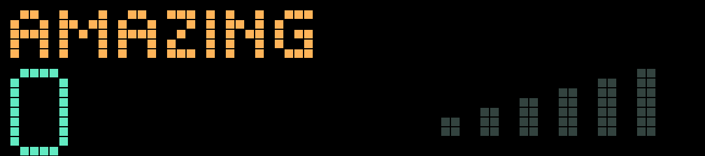
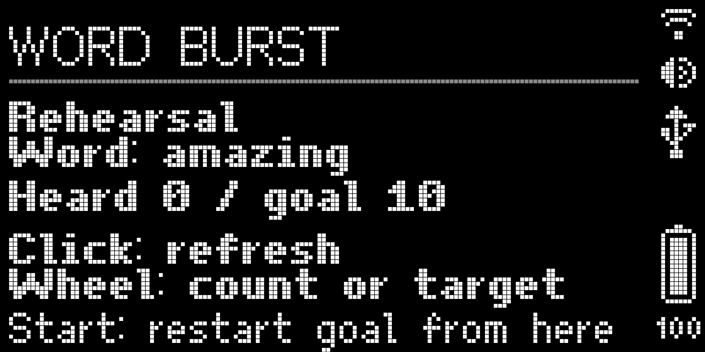
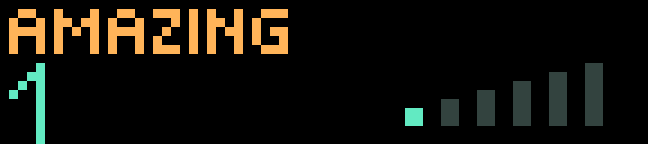

# Wordburst

Count a chosen spoken word with local speech recognition and a separate pixel firework for every match.

Rehearse a talk with the counter in sight. Three matches in one utterance become three separate bursts, so you can see how often the word slipped in without stopping to read a transcript.

## Screen transitions

Watch the word count advance as the rehearsal receives one hit and then a group of hits.



<details>

<summary>Watch the rear display</summary>



</details>

## Count a word during a rehearsal

1. Start the Mac companion with the word you want to count and connect the app to its URL. Check the rear display for the capture state.
2. Say a sentence containing the word, then pause. The companion recognizes the utterance locally and reports the updated count.
3. Watch the large number on the front. In this recording, speech from a prepared audio sample triggers the first hit on `amazing`.


## Follow several hits arriving together

1. Say the word more than once before pausing. When the companion reports the higher total, the display animates each new hit in turn.
2. The recording continues from the first hit to three. Once the last burst fades, the progress bars return.
3. Press **Start** if you want a goal five hits above the count on screen. For a different goal, turn the wheel to the target page and click to change it in steps of five.



## What was recorded

The firmware test used a prepared synthetic speech sample passed through the recognition pipeline. The counter animation is the emulator’s front display. A microphone, room noise and the choice of language model can change which words a live rehearsal picks up.

## Set up the source

Set a word, start the Mac companion, and place the bar near your screen. Say ‘amazing’ three times during a presentation and you get three hits. The counter is shared with the display. Wheel switches to the target editor, click changes the goal or refreshes the count, and Start sets a new target five hits above the current count.

## Recognize live speech

Install whisper.cpp and FFmpeg on the Mac. Download a compatible GGML model following [the upstream model instructions](https://github.com/ggml-org/whisper.cpp#quick-start). Use a multilingual model for Ukrainian. List microphone indices with `ffmpeg -f avfoundation -list_devices true -i empty`. Run `python3 companion/wordburst.py --microphone 0 --model /path/to/ggml-base.bin --language en --word amazing`. macOS asks for microphone access on first use. The computer recognizes short utterances locally after a pause. Recognition quality depends on microphone, language and model.

A live 16 kHz signed little-endian PCM source can also be piped into --pcm-stdin. For a recording, use `--wav talk.wav` instead of `--microphone 0` with 16 kHz mono PCM. Set Wordburst URL to `http://127.0.0.1:8770/wordburst` in the emulator and allow local port 8770. For hardware, bind the bridge to a trusted LAN address and enter that address on the device. Only the configured word, count, session ID and capture state travel to the display. Restarting the bridge starts a fresh count. Recognition of a long run of speech may be delayed until the next pause. The session runs only while you keep the companion open.

## Run in the emulator

Open BUSY Bar Emulator. From this repository, run:

```sh
~/.busy-emulator/bin/busy-emulator dev --once
```

Press **Back** to exit.

The GIFs are excerpts from the emulator recording. Each LED occupies a 16 × 16 cell with a black border. The end frames pause for reading.

[Full recording](media/count.mp4) · [Rear display](screenshots/back-1.png) · [Firmware test](EMULATOR-QA.md) · [MIT license](LICENSE)
